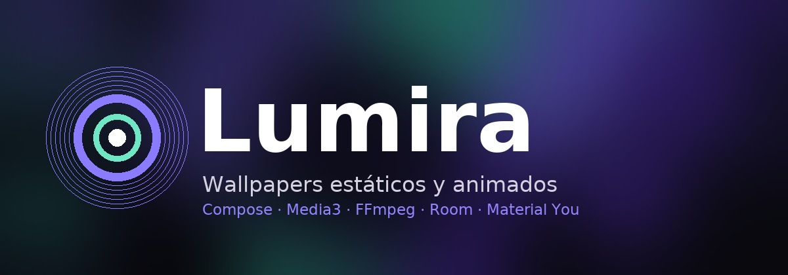
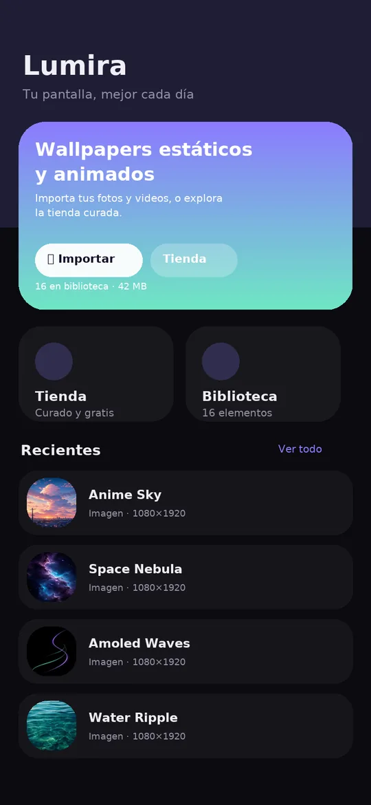
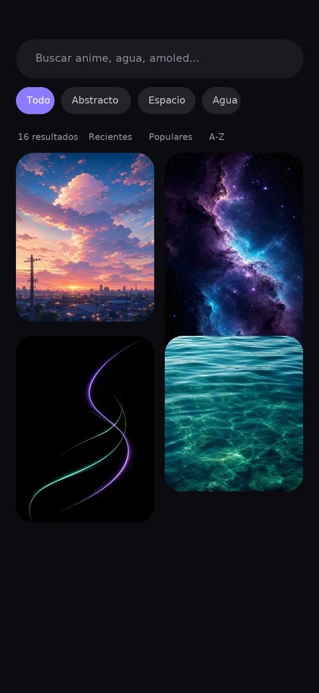
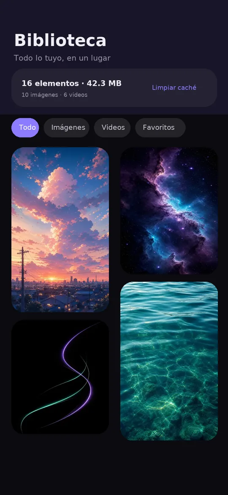
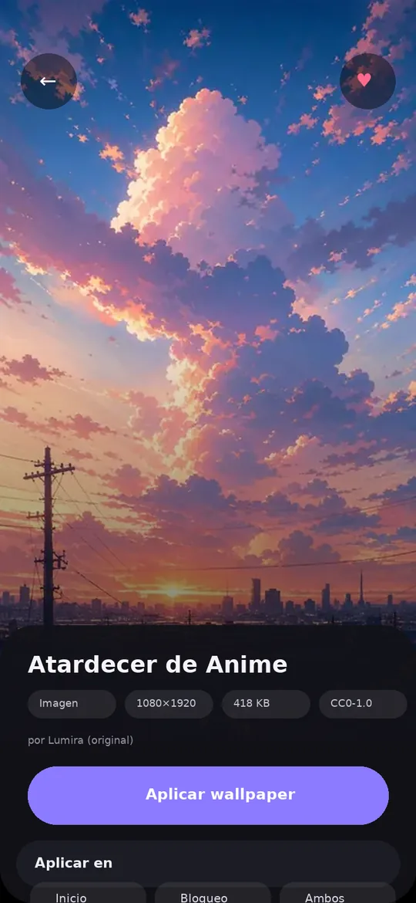

<div align="center">



# Lumira

**Wallpapers estáticos y animados, con biblioteca propia, tienda curada y mejora de video con IA-ready.**

[](https://github.com/karmaoriginal/potential-garbanzo/actions/workflows/build.yml)
[](https://github.com/karmaoriginal/potential-garbanzo/actions/workflows/publish-catalog.yml)
[](LICENSE)
[](#)
[](#)
[](#)

[Descargar APK](#-descargar-el-apk) · [Funciones](#-funciones) · [Arquitectura](#-arquitectura) · [Compilar](#-compilar) · [Tienda](#-añadir-contenido-a-la-tienda)

</div>

---

## ✨ Qué es Lumira

Lumira es una app Android **nativa (Kotlin + Jetpack Compose)** para poner tus fotos y
videos cortos como fondo de pantalla, o descargar wallpapers de una tienda curada con
contenido libre de regalías. Los videos se aplican con un **live wallpaper real**
(`WallpaperService` + ExoPlayer), con loop sin cortes, y se pueden **mejorar offline**
(escalado Lanczos, denoise, nitidez y H.265) en segundo plano.

| Inicio | Tienda | Biblioteca | Vista previa |
|:--:|:--:|:--:|:--:|
|  |  |  |  |

> Las capturas son **maquetas del diseño real** (generadas a partir del mismo lenguaje visual y
> del catálogo incluido). Sustitúyelas por capturas de dispositivo cuando publiques el APK.

---

## 🧩 Funciones

### 1. Wallpapers propios
- Importación con **Photo Picker** (`PickMultipleVisualMedia`) y **SAF** — sin permisos de
  almacenamiento amplios (las entradas `READ_MEDIA_*` se eliminan explícitamente del manifest).
- Imágenes: **JPG, PNG, WEBP, HEIC/HEIF, AVIF, GIF, BMP**.
- Videos: **MP4, MKV, WEBM, MOV, 3GP, M4V, TS**.
- Detección de duplicados, orientación EXIF corregida, miniaturas WebP de 480 px.

### 2. Aplicar
- **Fotos** con `WallpaperManager`: inicio, bloqueo o ambos, con control de encuadre vertical
  antes de aplicar (`focusY`) y recomposición al tamaño real de pantalla.
- **Videos** con `VideoWallpaperService` (ExoPlayer + `SurfaceHolder`):
  - decodificación por hardware, `REPEAT_MODE_ONE` para loop continuo,
  - modo de escalado *cover* (sin barras negras),
  - pausa al apagar pantalla, al no estar visible el launcher y en ahorro de batería,
  - opción de silenciar y límite de 30/60 fps,
  - liberación explícita del player (sin fugas).

### 3. Mejora de calidad de video (offline)
- Se ofrece **una sola vez** tras importar, con `WorkManager` (restricciones: cargando + batería
  no baja, notificación en primer plano, cancelable).
- Cadena FFmpeg: `scale=…:flags=lanczos` → `hqdn3d` → `unsharp` → `format=yuv420p`.
- **H.265** por `hevc_mediacodec` (DSP, rápido y eficiente) con *fallback* a `libx265`.
- Progreso en Room + `WorkInfo` (sobrevive a la muerte del proceso), y cancelación inmediata.
- **Interfaz `AiUpscaler` lista** para un modelo ligero (TFLite/ESPCN), desactivada por defecto.

### 4. Tienda integrada
- `catalog.json` **versionado** en el repo, publicado con **GitHub Pages**.
- Archivos pesados en **GitHub Releases** (`catalog-v1`); miniaturas WebP (≤40 KB) y previews
  de 3 s en el propio repo.
- Categorías (abstracto, espacio, agua, AMOLED, naturaleza, colores, minimalista, anime),
  buscador con **FTS4 + debounce**, orden por recientes/populares/tendencia/A-Z, filtros por
  tipo, favoritos y "tendencia" basada en vistas locales.
- **Descarga reanudable** con peticiones `Range` y `.part`, registro automático en la biblioteca.

### 5. Biblioteca local
- Importados + descargados en la misma grid; renombrar, borrar, favoritos, mejorar.
- Espacio usado (total, caché, miniaturas) y limpieza de caché bajo demanda o automática.

---

## 🎨 UI/UX

- **Material 3** con **color dinámico (Material You)** en Android 12+ y paleta propia de marca.
- **Modo AMOLED** (negro puro) y dark mode forzable.
- **Masonry** real con `LazyVerticalStaggeredGrid`, keys estables y *content types*.
- Transiciones de navegación (slide/scale/fade) y **shimmer/skeleton** en cargas.
- Efectos de **press** con springs en la capa gráfica (sin recomposición).
- **Vista previa a pantalla completa** "probar antes de aplicar", con la UI real encima del fondo.
- Todos los textos en español, formato `es-MX` para tamaños.

---

## 🏗 Arquitectura

```
app/src/main/kotlin/app/lumira/wallpapers/
├── MainActivity.kt              # edge-to-edge, tema desde DataStore, navegación
├── LumiraApp.kt                 # ImageLoader único, canales, bootstrap de workers
├── di/ServiceLocator.kt         # contenedor manual (sin framework DI)
├── data/
│   ├── local/                   # Room: wallpapers, downloads, signals, FTS4, historial
│   ├── prefs/                   # DataStore tipado (Settings)
│   ├── media/                   # MediaProbe, MediaFormats, BitmapTools
│   ├── repo/WallpaperRepository # importación, CRUD, stats, limpieza
│   ├── shop/                    # CatalogRepository (ETag), Downloader (Range), NetworkMonitor
│   └── CacheWorker.kt           # housekeeping periódico
├── domain/model/                # Wallpaper, Category, MediaKind, ApplyTarget…
├── enhance/                     # VideoEnhancer (FFmpeg), EnhanceWorker, Scheduler
├── wallpaper/                   # VideoWallpaperService, WallpaperApplier, WallpaperPrefs
├── ui/
│   ├── theme/                   # Material 3, tipografía, formas, tokens extra
│   ├── components/              # WallpaperCard, MasonryGrid, Shimmer…
│   ├── nav/                     # LumiraNavHost
│   ├── screens/                 # home, shop, library, detail, settings
│   └── *ViewModel.kt            # MVVM con StateFlow
└── util/                        # FileStore, ImageUtils
```

**Stack:** Kotlin 2.0 · Compose (BOM 2025.01) · Material 3 · Navigation Compose ·
Room 2.6 (KSP) · DataStore · WorkManager · Media3 ExoPlayer 1.5 · Coil 2.7 (GIF/AVIF/HEIC/video)
· OkHttp 4 · kotlinx.serialization · ffmpeg-kit `8.1.9` (fork mantenido en Maven Central).

**Decisiones clave**
- **Sin Hilt/Koin**: un `ServiceLocator` de ~60 líneas evita cientos de métodos y un procesador
  de anotaciones extra (APK y tiempo de build menores).
- **Sin Ktor**: OkHttp + serialization cubren catálogo y descargas sin arrastrar un engine.
- **Sin Compose "dynamic feature"**: los splits por ABI ya reducen el APK; los módulos extra no
  aportaban al ser una app única.

---

## ⚡ Optimización

| Área | Medida |
|---|---|
| **Tamaño** | R8 + `shrinkResources`, splits por ABI (arm64-v8a principal), recursos vectoriales, `nonTransitiveRClass`, sin librerías de DI/imagen pesadas. |
| **Arranque** | Baseline Profile (`src/main/baseline-prof`), splash nativo, tema desde DataStore con `stateIn`. |
| **Scroll** | `LazyVerticalStaggeredGrid` con `key` estable, `contentType`, sin trabajo por frame. |
| **Imágenes** | Coil con memoria al 22 % del heap y disco acotado; decodificación a tamaño de pantalla. |
| **Video** | Decodificación HW, pausa con pantalla apagada / launcher oculto / ahorro, FPS limitables, `ExoPlayer.release()` garantizado. |
| **Batería** | WorkManager con `requiresCharging` + `batteryNotLow`; limpieza diaria solo con `deviceIdle`. |
| **Almacenamiento** | No se duplica el archivo importado (se copia una vez), `.part` reanudables, caché con límite configurable. |

---

## 📲 Descargar el APK

Elige **una** de estas vías:

1. **Releases** (recomendado, versiones estables)
   **[github.com/karmaoriginal/potential-garbanzo/releases](https://github.com/karmaoriginal/potential-garbanzo/releases)**
   → `Lumira v1.0.0` → descarga **`app-arm64-v8a-release.apk`** (27 MB, cualquier móvil de 2017+).
   Para emuladores: `app-x86_64-release.apk` (31 MB).

2. **GitHub Actions** (último build de `main`)
   `Actions → Build APK → último run verde → Artifacts → lumira-apk-<n>`

3. **Compilando tú mismo** (ver abajo).

> Instalación: permite "instalar apps desconocidas" para tu navegador/gestor de archivos.
> Requiere **Android 8.0 (API 26)** de 64 bits (`arm64-v8a` o `x86_64`). Los APK existentes
> están firmados con una clave efímera generada por CI: para actualizaciones limpias configura
> los secrets de firma (ver *Compilar*).

---

## 🔨 Compilar

```bash
git clone https://github.com/karmaoriginal/potential-garbanzo.git
cd potential-garbanzo

# APK de release (firma con debug si no hay keystore configurado)
./gradlew assembleRelease
# ABI concreta, más rápido en local:
./gradlew assembleRelease -Pandroid.injected.build.abi=arm64-v8a

# Tests unitarios
./gradlew testDebugUnitTest
```

Salida: `app/build/outputs/apk/release/app-<abi>-release.apk`.

**Firma con tu propia clave** (opcional). Crea `keystore.properties` en la raíz:

```properties
storeFile=/ruta/a/release.jks
storePassword=••••
keyAlias=lumira
keyPassword=•••
```

…o exporta `LUMIRA_KEYSTORE_FILE`, `LUMIRA_KEYSTORE_PASSWORD`, `LUMIRA_KEY_ALIAS`,
`LUMIRA_KEY_PASSWORD`. En CI también puedes configurar los secrets
`KEYSTORE_BASE64`, `KEYSTORE_PASSWORD`, `KEY_ALIAS`, `KEY_PASSWORD`.

**Requisitos:** JDK 17, Android SDK 35. El workflow genera un keystore efímero si no hay secrets,
así que el repo compila **sin configuración manual**.

### CI / CD

`.github/workflows/build.yml`
- push a `main` y `workflow_dispatch`
- JDK 17 + cache de Gradle + `--stacktrace` + `build.log` como artefacto (`if: always()`)
- APK firmado como artefacto; resumen con tamaños y warnings en el *Job Summary*
- tag `v*` → **GitHub Release** con los APK adjuntos

`.github/workflows/publish-catalog.yml`
- sube los originales a la release `catalog-v1` y despliega `docs/` en GitHub Pages
- verifica que `catalog.json` responda 200 y tenga el número esperado de items

---

## 🛍 Añadir contenido a la tienda

El catálogo es **datos, no código**. Tres pasos:

1. **Añade el archivo original** a `tools/catalog-src/full/` (imagen, 1080×1920 recomendado) o
   `tools/catalog-src/video/` (loop MP4 ≤ 10 s, `-movflags +faststart`).
2. **Genera la miniatura** en `docs/catalog/thumbs/<slug>.webp` (400 px de ancho, WebP ~q72) y,
   si es video, un preview de 3 s en `docs/catalog/previews/<slug>.mp4`:

   ```bash
   ffmpeg -i entrada.jpg -vf scale=400:-1 -q:v 75 docs/catalog/thumbs/mi-slug.webp
   ffmpeg -i loop.mp4 -t 3 -vf scale=360:-2 -c:v libx264 -crf 30 -an docs/catalog/previews/mi-slug.mp4
   ```

3. **Añade el item a `docs/catalog/catalog.json`** (sube también `version` y `updatedAt`):

   ```json
   {
     "id": "mi-slug",
     "title": "Mi Wallpaper",
     "category": "nature",
     "kind": "image",
     "thumb": "thumbs/mi-slug.webp",
     "preview": "",
     "full": "https://github.com/USUARIO/REPO/releases/download/catalog-v1/mi-slug.jpg",
     "width": 1080, "height": 1920, "durationMs": 0,
     "bytes": 420000,
     "tags": ["verde", "bosque", "oscuro"],
     "license": "CC0-1.0",
     "author": "Tu nombre", "sourceUrl": "https://…",
     "popularity": 100, "addedAt": 1763000000000,
     "blurHash": ""
   }
   ```

   - `thumb`, `preview` y `full` pueden ser **relativos a `baseUrl`** o URLs absolutas.
   El catálogo se publica en dos URLs equivalentes:
   `raw.githubusercontent.com/…/main/docs/catalog/catalog.json` (por defecto en la app) y
   `karmaoriginal.github.io/potential-garbanzo/catalog/catalog.json` (GitHub Pages, si está activo).
   Si Pages no está habilitado en tu fork, activa *Settings → Pages → Deploy from a branch: main /docs*.
   - `kind`: `image` o `video`. `durationMs` solo aplica a videos.
   - La app indexa automáticamente `title`, `tags` y `category` en FTS para el buscador.

4. Haz commit y push. El workflow **Publish catalog** sube los archivos nuevos a la Release,
   despliega Pages y verifica el catálogo. Aparecerá en la app sin actualizar el APK (pull to refresh
   / reentrar en la tienda invalida por ETag).

**Licencias aceptadas:** CC0, Pixabay License, Pexels License, Unsplash License o arte original.
**Nunca** añadas material con copyright de terceros (personajes, logos, capturas, fan-art sin permiso).

---

## 🗺 Roadmap

- [ ] Fondo animado con **video + parallax por sensor** (giroscopio) opcional.
- [ ] Upscaler con IA real (ESPCN/Real-ESRGAN-tiny en TFLite + NNAPI).
- [ ] Reprogramación del live wallpaper por hora del día (colecciones rotativas).
- [ ] Compartir colecciones y sincronizar favoritos (GitHub Gist / cuenta).
- [ ] Widget y atajos de "aplicar aleatorio".
- [ ] Baseline Profile medido con Macrobenchmark en dispositivos de referencia.
- [ ] Descarga en cola con reintentos exponenciales y notificación agregada.

---

## 🙏 Créditos y licencias del contenido

- **Arte y clips del catálogo**: originales, generados para Lumira y derivados procedurales.
  Licencia **CC0 1.0 Universal** (dominio público). Archivos pesados en la release
  [`catalog-v1`](https://github.com/karmaoriginal/potential-garbanzo/releases/tag/catalog-v1).
- La app se apoya en proyectos de código abierto: **AndroidX / Jetpack Compose** (Apache-2.0),
  **Media3** (Apache-2.0), **Coil** (Apache-2.0), **OkHttp** (Apache-2.0),
  **kotlinx.serialization** (Apache-2.0), **Room** (Apache-2.0),
  **FFmpegKit** vía el fork mantenido [`dev.ffmpegkit-maintained`](https://github.com/ffmpegkit-maintained/ffmpeg)
  (**LGPL-3.0**, artefacto `ffmpeg-kit-video`, enlazado dinámicamente) y **FFmpeg** (LGPL-2.1+).
- Rutas de código de terceros: FFmpeg (FFmpeg Team), Google (Android).

> Nota legal: `ffmpeg-kit-video` es LGPL. Lumira lo usa como biblioteca compartida sin
> modificar su código; si redistribuyes el APK, conserva los avisos de licencia incluidos en
> `META-INF`.

---

## 📄 Licencia

Código bajo **MIT** — ver [LICENSE](LICENSE).
Contenido del catálogo bajo **CC0-1.0**.

<div align="center"><sub>Hecho con ☕ y Compose · Lumira 1.0.0</sub></div>
